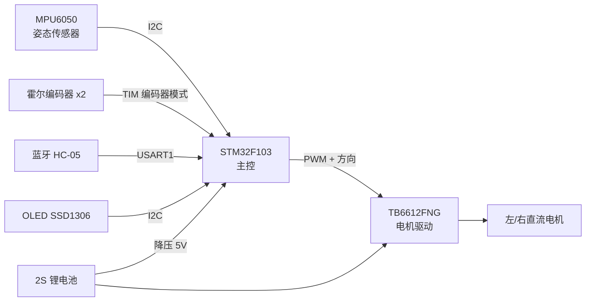

[README.md](https://github.com/user-attachments/files/34173167/README.md)
# 两轮自平衡小车 | Balance Car

基于 **STM32** 的两轮自平衡小车：MPU6050 采集姿态，串级 PID 实现直立、速度、转向控制，支持蓝牙遥控与参数在线调节。


---

## 目录

- [项目简介](#项目简介)
- [功能特性](#功能特性)
- [硬件清单](#硬件清单)
- [系统架构](#系统架构)
- [控制原理](#控制原理)
- [目录结构](#目录结构)
- [快速开始](#快速开始)
- [使用说明](#使用说明)
- [PID 调参指南](#pid-调参指南)
- [常见问题](#常见问题)
- [参考资料](#参考资料)
- [许可证](#许可证)

---

## 项目简介

本项目是一个从零手写的两轮自平衡小车固件与硬件工程，目标是完整走通「姿态解算 → 串级 PID → 电机闭环」的控制链路。
代码不依赖 RTOS，主循环以 5 ms 为周期运行。

- **主控**：STM32F103C8T6（Cortex-M3, 72 MHz）
- **姿态**：MPU6050，互补滤波融合加速度计与陀螺仪
- **执行**：TB6612FNG 双路驱动 + 带霍尔编码器的直流减速电机
- **控制**：直立环（PD）+ 速度环（PI）+ 转向环（P）并联输出


## 功能特性

-  姿态解算：互补滤波，输出俯仰角与角速度
-  串级 PID：直立 / 速度 / 转向三环独立调参
-  编码器测速：定时器编码器模式，1024 线/圈
-  蓝牙遥控：前进、后退、转向、急停
-  参数在线调节：串口/蓝牙发送指令实时改 PID
-  OLED 实时显示角度、PWM、电池电压


## 硬件清单

| 部件 | 型号 | 数量 | 说明 |
| --- | --- | --- | --- |
| 主控板 | STM32F103C8T6 最小系统板 | 1 | 72 MHz，64 KB Flash |
| 姿态传感器 | MPU6050 | 1 | I2C1，PB6/PB7 |
| 电机驱动 | TB6612FNG | 1 | PWM: TIM2_CH1~CH4 |
| 直流减速电机 | 12 V，带霍尔编码器 | 2 | 减速比 1:30 |
| 编码器 | 11 线霍尔编码器 | 2 | TIM3/TIM4 编码器模式 |
| 显示屏 | 0.96" OLED SSD1306 | 1 | I2C，可选 |
| 蓝牙模块 | HC-05 / JDY-31 | 1 | USART1，115200 8N1 |
| 电池 | 2S 18650（7.4 V） | 1 | 经 LM2596 降压至 5 V |
| 车体 | 亚克力 / 3D 打印底盘 | 1 | 重心尽量低 |


## 系统架构



## 控制原理

三环**并联**后叠加为左右轮 PWM：

```
pwm_left  = balance_out + velocity_out + turn_out
pwm_right = balance_out + velocity_out - turn_out
```

| 环 | 类型 | 输入 | 作用 |
| --- | --- | --- | --- |
| 直立环 | PD | 俯仰角误差、角速度 | 让车身保持竖直，响应最快（内环） |
| 速度环 | PI | 编码器测得速度与目标速度之差 | 抑制长期漂移、维持位置（外环） |
| 转向环 | P | 目标转向量 / 陀螺仪 Z 轴角速度 | 实现原地转向与直线纠偏 |

直立环输出：

```c
balance_out = Kp_angle * (pitch - pitch_offset) + Kd_angle * gyro_y;
```

速度环输出：

```c
velocity_out += Kp_speed * (target_speed - actual_speed) + Ki_speed * speed_error;
```

> `pitch_offset` 是机械中值，需在车身静止直立时实测标定。

## 目录结构

```text
balance-car/
├── Core/
│   ├── Inc/                 # 头文件
│   └── Src/
│       ├── main.c           # 主循环、初始化
│       ├── pid.c            # PID 控制器
│       ├── mpu6050.c        # 姿态读取与互补滤波
│       ├── motor.c          # TB6612 驱动与编码器测速
│       ├── oled.c           # OLED 显示
│       └── bluetooth.c      # 串口协议解析
├── Drivers/                 # CMSIS + 标准外设库 / HAL
├── MDK-ARM/
│   └── balance_car.uvprojx  # Keil 工程文件
├── docs/                    # 图片、原理图、说明
├── .gitignore
└── README.md
```

## 快速开始

### 开发环境

| 工具 | 版本 / 说明 |
| --- | --- |
| Keil MDK | 5.38 及以上 |
| STM32F1xx 器件支持包 | Keil.STM32F1xx_DFP |
| ST-Link 驱动 / DAP-Link | 用于烧录与调试 |
| 串口助手 | 波特率 115200，用于查看日志 |

### 编译

1. 用 Keil 打开 `MDK-ARM/balance_car.uvprojx`
2. 菜单 `Project → Build Target`（快捷键 `F7`）
3. 确认输出窗口为 `0 Error(s), 0 Warning(s)`

### 烧录

1. 按 `SWDIO / SWCLK / GND / 3.3V` 连接下载器与主控板
2. `Options for Target → Debug` 选择 `ST-Link Debugger`，`Settings → Port: SW`
3. 菜单 `Flash → Download`（快捷键 `F8`），看到 `Application running...` 即成功

## 使用说明

**上电流程**

1. 把小车扶正、保持静止约 2 秒，等待陀螺仪零偏校准
2. OLED 显示 `Ready` 后松手，小车自动进入平衡状态
3. 若车身持续前倾/后仰，说明机械中值 `pitch_offset` 需要重新标定

**蓝牙指令**

| 指令 | 功能 |
| --- | --- |
| `F` | 前进 |
| `B` | 后退 |
| `L` / `R` | 左转 / 右转 |
| `S` | 急停 |
| `P<数值>` | 设置直立环 Kp，例如 `P120` |
| `I<数值>` | 设置速度环 Ki |
| `D<数值>` | 设置直立环 Kd |
| `RST` | 恢复默认参数 |

## PID 调参指南

**顺序：直立环 → 速度环 → 转向环**，每次只改一个参数，幅度 10%~20%。

| 现象 | 调整方向 |
| --- | --- |
| 车身低频大幅前后摇摆 | 增大直立环 `Kp`，或适当增大 `Kd` |
| 高频抖动、电机啸叫 | 减小直立环 `Kp`，增大 `Kd`，或缩短控制周期 |
| 始终朝一个方向跑 | 校准 `pitch_offset`，或增大速度环 `Ki` |
| 刹车点头、回中慢 | 适当增大速度环 `Kp` |
| 转向迟钝 / 画龙 | 增大转向环 `Kp`，或加入陀螺仪 Z 轴阻尼 |


## 常见问题

| 问题 | 可能原因与解决 |
| --- | --- |
| 上电后电机疯转 | 陀螺仪零偏未校准；或电机正负极接反 |
| 串口输出乱码 | 波特率不匹配，检查是否为 115200 |
| 编译报 `core_cm3.h not found` | 未安装 STM32F1xx 器件支持包 |
| 烧录提示 `No target connected` | 检查 SWD 接线、板子是否上电、是否被读保护 |
| 小车原地打转 | 左右电机接线或编码器方向相反，交换其中一路 |


## 参考资料

- [MPU6050 数据手册与寄存器说明](https://invensense.tdk.com/products/motion-tracking/6-axis/mpu-6050/)
- [TB6612FNG 数据手册](https://www.sparkfun.com/datasheets/Robotics/TB6612FNG.pdf)
- 平衡小车之家：串级 PID 调参经验

## 许可证

本项目基于 [MIT License](LICENSE) 开源，欢迎 Fork 与提交 Issue。

## 致谢

感谢开源社区提供的驱动参考与调参经验分享。

---

**作者**：LLuqing · **仓库**：https://github.com/LLuqing/balance-car
